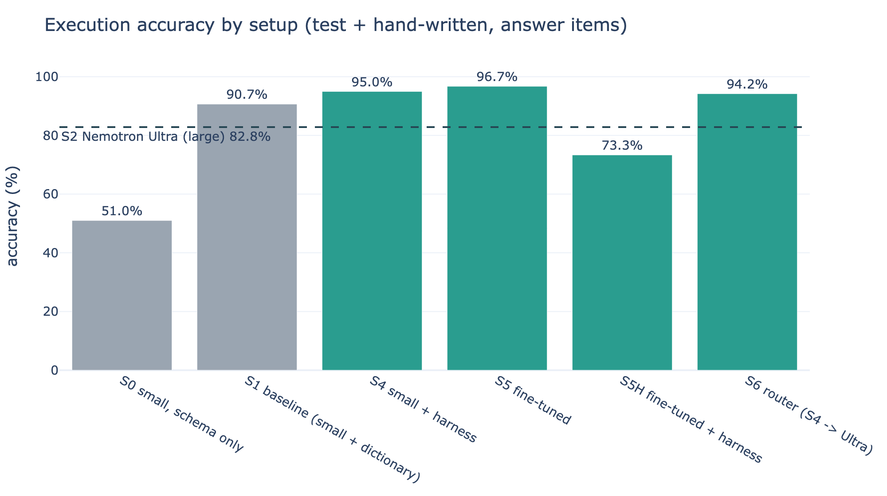
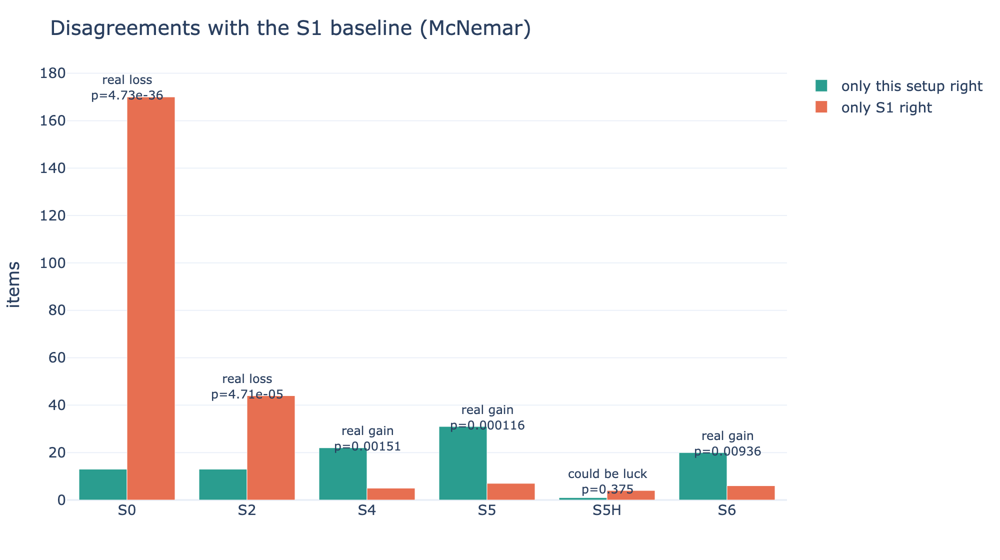
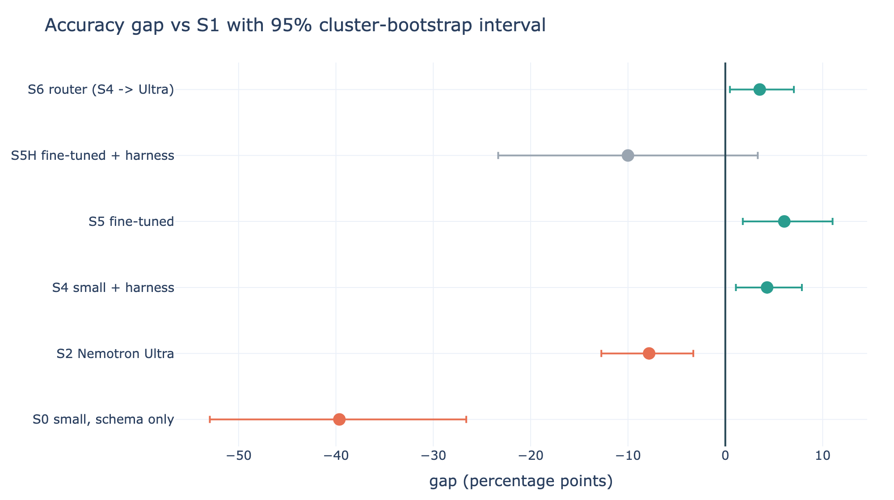
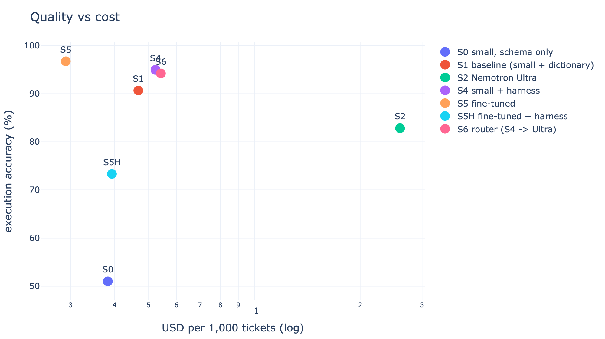
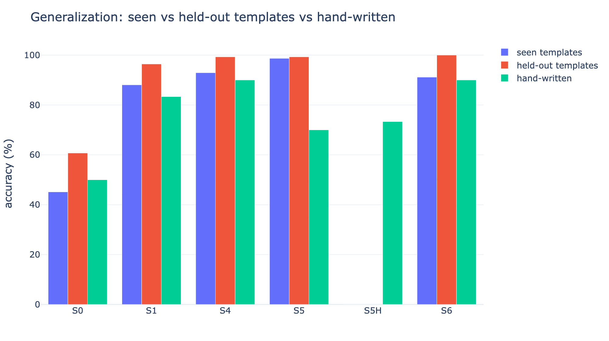

# QueryForge

**Turns a company database plus its business rules into a data agent that answers data-request tickets in seconds, and proves the gain on a fixed benchmark.**

Built for the Fireworks Deploy Buildathon (Nov 2, 2026). Every model runs on Fireworks: GLM 5.3 Flash as the small model, NVIDIA Nemotron 3 Ultra as the large reference and escalation tier, and a LoRA fine-tune trained with Fireworks serverless training.

---

## The problem

PMs, auditors and ops staff need numbers, but they can't write SQL. They file a ticket and wait hours or days for a data engineer. Definitions drift too: is "revenue" with or without canceled orders? Who counts as a "customer"? Generic models don't know a company's rules, so they get exactly those questions wrong.

**User:** a PM or auditor asks in plain English. **Benefit:** an answer in about 3 seconds, with the SQL, an explanation and the assumptions it made. Every answer is logged. Data engineers only see tickets the agent escalates or a person flags.

```
ticket ─► pre-filter ─► model writes SQL ─► safety check ─► read-only DuckDB ─► sanity checks ─► answer + SQL + assumptions ─► audit log
            │ (write/PII/injection → refuse)       │ (error → retry ×2)        │ (warning → 1 repair, else low confidence)
            └── ambiguous → asks a clarifying question            low confidence → router escalates to Nemotron Ultra → then a human
```

## Results

<!-- RESULTS:START -->
### Headline: S5 fine-tuned vs S1 baseline (combined test + hand-written)

| Metric | S1 baseline | Best | Gain |
|---|---|---|---|
| Execution accuracy (answer items) | 90.7% | 96.7% | +6.1 pts |
| Behavior accuracy (clarify/refuse) | 92.0% | 100.0% | +8.0 pts |
| Cost per 1k tickets (USD) | 0.4674 | 0.2907 | -0.177 |
| p50 latency (ms) | 3143 | 4008 | +865 |

Accuracy gap +6.1 pts, 95% cluster-bootstrap CI [+1.8, +11.0], McNemar p = 0.0001 (31 items only S5 got right vs 7 only S1 got right) -> **real gain**.

### All setups

| Setup | Items run (test / hw) | Test acc | Hand-written acc | Combined acc | Seen tmpl | Unseen tmpl | Behavior | p50 ms | $/1k tickets | vs S1, paired on same answer items |
|---|---|---|---|---|---|---|---|---|---|---|
| S0 small, schema only | 416 / 30 | 51.1% | 50.0% | 51.0% | 45.1% | 60.7% | 92.0% | 3867 | 0.383 | -39.6 pts, p=0.000, real loss (n=396) |
| S1 baseline (small + dictionary) | 416 / 30 | 91.3% | 83.3% | 90.7% | 88.1% | 96.4% | 92.0% | 3143 | 0.467 | baseline |
| S2 Nemotron Ultra | 416 / 30 | 83.1% | 80.0% | 82.8% | 76.1% | 94.3% | 98.0% | 7499 | 2.597 | -7.8 pts, p=0.000, real loss (n=396) |
| S4 small + harness | 416 / 30 | 95.4% | 90.0% | 95.0% | 92.9% | 99.3% | 92.0% | 3240 | 0.523 | +4.3 pts, p=0.002, real gain (n=396) |
| S5 fine-tuned | 416 / 30 | 98.9% | 70.0% | 96.7% | 98.7% | 99.3% | 100.0% | 4008 | 0.291 | +6.1 pts, p=0.000, real gain (n=396) |
| S5H fine-tuned + harness | 0 / 30 | - | 73.3% | 73.3% | - | - | - | 46611 | 0.393 | -10.0 pts, p=0.375, could be luck (n=30) |
| S6 router (S4 -> Ultra) | 416 / 30 | 94.5% | 90.0% | 94.2% | 91.2% | 100.0% | 90.0% | 3069 | 0.542 | +3.5 pts, p=0.009, real gain (n=396) |

### Paired vs S1 on the same items (S1 acc → setup acc (gap; only-setup-right/only-S1-right; McNemar p; verdict) n)

| Setup | Seen templates | Held-out templates | Hand-written | Behavior (clarify/refuse) |
|---|---|---|---|---|
| S0 | 88.1 → 45.1 (-42.9; 12/109; p=9.87e-21; real loss) n=226 | 96.4 → 60.7 (-35.7; 1/51; p=2.35e-14; real loss) n=140 | 83.3 → 50.0 (-33.3; 0/10; p=0.00195; real loss) n=30 | 92.0 → 92.0 (+0.0; 1/1; p=1; could be luck) n=50 |
| S2 | 88.1 → 76.1 (-11.9; 10/37; p=9.85e-05; real loss) n=226 | 96.4 → 94.3 (-2.1; 2/5; p=0.453; could be luck) n=140 | 83.3 → 80.0 (-3.3; 1/2; p=1; could be luck) n=30 | 92.0 → 98.0 (+6.0; 3/0; p=0.25; could be luck) n=50 |
| S4 | 88.1 → 92.9 (+4.9; 16/5; p=0.0266; real gain) n=226 | 96.4 → 99.3 (+2.9; 4/0; p=0.125; could be luck) n=140 | 83.3 → 90.0 (+6.7; 2/0; p=0.5; could be luck) n=30 | 92.0 → 92.0 (+0.0; 0/0; p=1; could be luck) n=50 |
| S5 | 88.1 → 98.7 (+10.6; 25/1; p=8.05e-07; real gain) n=226 | 96.4 → 99.3 (+2.9; 5/1; p=0.219; could be luck) n=140 | 83.3 → 70.0 (-13.3; 1/5; p=0.219; could be luck) n=30 | 92.0 → 100.0 (+8.0; 4/0; p=0.125; could be luck) n=50 |
| S5H | - | - | 83.3 → 73.3 (-10.0; 1/4; p=0.375; could be luck) n=30 | - |
| S6 | 88.1 → 91.2 (+3.1; 13/6; p=0.167; could be luck) n=226 | 96.4 → 100.0 (+3.6; 5/0; p=0.0625; could be luck) n=140 | 83.3 → 90.0 (+6.7; 2/0; p=0.5; could be luck) n=30 | 92.0 → 90.0 (-2.0; 0/1; p=1; could be luck) n=50 |

### S4 vs S2 (Nemotron Ultra), paired (S2 acc → S4 acc)

| Slice | Result |
|---|---|
| Answer items, test + hand-written | 82.8 → 94.9 (+12.1; 53/5; p=3.5e-11; real gain) n=396 |
| Hand-written only | 80.0 → 90.0 (+10.0; 3/0; p=0.25; could be luck) n=30 |
| Behavior (clarify/refuse) | 98.0 → 92.0 (-6.0; 0/3; p=0.25; could be luck) n=50 |

### Accuracy by category (combined)

| Setup | simple | join | date | business_rule | gotcha | clarify | refuse |
|---|---|---|---|---|---|---|---|
| S0 | 93.1% | 90.7% | 27.9% | 12.8% | 75.7% | 84.0% | 100.0% |
| S1 | 91.4% | 81.4% | 97.7% | 92.6% | 88.3% | 84.0% | 100.0% |
| S2 | 84.5% | 72.1% | 86.0% | 85.2% | 81.6% | 96.0% | 100.0% |
| S4 | 96.6% | 88.4% | 95.3% | 96.6% | 94.2% | 84.0% | 100.0% |
| S5 | 96.6% | 95.3% | 97.7% | 96.6% | 97.1% | 100.0% | 100.0% |
| S5H | 66.7% | 100.0% | 66.7% | 69.2% | 75.0% | - | - |
| S6 | 98.3% | 83.7% | 97.7% | 96.6% | 91.3% | 80.0% | 100.0% |
<!-- RESULTS:END -->







Per-question results for every run are committed under `eval/runs/{setup}_{test|hw}/results.jsonl`, each next to a `manifest.json` that records the full system prompt, model, settings, test-file SHA256 and git commit.

## What we found

<!-- FINDINGS:START -->
1. **The business rules are most of the value.** Adding the data dictionary to the same small model takes it from 51.0% to 90.7% (S0 → S1, p < 0.001). With the rules in the prompt, the small GLM baseline already beats Nemotron Ultra (S2: 82.8%).
2. **The harness is a real, robust gain** (S4 vs S1: +4.3 points, McNemar p = 0.0015, 95% CI [+1.1, +7.9], 22 vs 5 discordant items).
   - **How it gets there:** showing the model real column values (e.g. `cool_stuff` rather than "cool stuff"), retrying SQL errors, and sanity checks.
   - **Cost:** about the same as S1 ($0.52 vs $0.47 per 1k tickets).
   - **Where it shows:** it improves or matches S1 on every slice: seen templates, held-out templates and hand-written questions.
3. **Fine-tuning gives the best score on the frozen test, but it doesn't transfer to differently worded questions.**
   - **Overall:** S5 scores 96.7% vs 90.7% (+6.1 points, p = 0.0001, CI [+1.8, +11.0]), at the lowest cost of any setup, $0.29 per 1k (no reasoning tokens).
   - **Held-out templates:** it's just as strong (99.3% vs 96.4%), so it learned the rules, not just the templates.
   - **Hand-written questions:** it **drops to 70.0% vs 83.3%** (1 vs 5 discordant; not significant at n = 30, but the direction is clear).
   - **The causes are visible in the outputs:**
     - It returns a fraction when the user asks for "%" (every training answer was a fraction).
     - It skips steps on multi-part questions, because it was trained to answer without reasoning.
   - **Fixes for a next round:** add percentage and multi-step examples to the training data, or keep a short reasoning trace.
4. **Routing to Nemotron Ultra didn't help.** S6 escalates S4's low-confidence or failed answers to Nemotron 3 Ultra. It scored 94.2%, close to S4 (95.0%), at slightly higher cost.
   - Nemotron 3 Ultra is the large-model reference (S2) and the escalation tier (S6) in this system.
   - Ultra on its own is better at clarify/refuse (98% vs 92%, n = 50, not significant), but worse at writing the SQL.
5. **Recommended production setup: S4** (GLM 5.3 Flash + harness).
   - It's the only setup that improves on every slice, including the hand-written questions closest to real tickets.
   - S5's in-distribution win is real, but a model that drops on new phrasing is riskier for real tickets until the fixes above are in.

**Hand-written questions (n = 30), paired McNemar vs S1.** n = 30 is small: a gap needs about 5 or more net discordant items to reach p < 0.05, so treat these as directional.

| Setup | S1 → setup | Only setup right / only S1 right | McNemar p |
|---|---|---|---|
| S0 schema only | 83.3% → 50.0% | 0 / 10 | 0.002 |
| S2 Nemotron Ultra | 83.3% → 80.0% | 1 / 2 | 1.00 |
| S4 harness | 83.3% → 90.0% | 2 / 0 | 0.50 |
| S5 fine-tuned | 83.3% → 70.0% | 1 / 5 | 0.22 |
| S5H fine-tuned + harness | 83.3% → 73.3% | 1 / 4 | 0.38 |
| S6 router | 83.3% → 90.0% | 2 / 0 | 0.50 |

**S4 vs Nemotron Ultra (S2), paired:**
- **Answer items:** 82.8% → 94.9% (+12.1 points, 53 vs 5 discordant, p = 3.5e-11, CI [+7.2, +17.3]). That's a significant win.
- **Hand-written only:** +10.0 points, p = 0.25, not significant.
- **Clarify/refuse:** −6.0 points, p = 0.25, not significant.
<!-- FINDINGS:END -->

## Business value

These are **assumptions, not measurements** from a deployment. Change them to fit your team.

| Assumption | Value | Source / reasoning |
|---|---|---|
| Data tickets per month | **200** | Assumed: a mid-size product/ops org (about 10 a working day) |
| Engineer minutes per ticket today | **30 min** | Assumed: read the ticket, find the tables, write and check the SQL, reply |
| Requester minutes per ticket with QueryForge | **5 min** | Assumed: read the answer, the SQL and the stated assumptions, then Approve or Flag |
| Share of tickets QueryForge resolves | **90%** | Below S4's measured 95% execution accuracy (94.9% on test + hand-written) to leave margin. The other 10% go to an engineer as today |
| Hourly wage | **$54.13/hour** | US median pay for data scientists, 2024 ([BLS Occupational Outlook Handbook](https://www.bls.gov/ooh/math/data-scientists.htm)) |
| Model cost per ticket | **$0.00052** (S4), $0.0026 (S2) | Measured: tokens × Fireworks serverless prices in `config.yaml` |

**Math:** 200 tickets × 90% resolved × (30 − 5) min ÷ 60 × $54.13/h = 75 engineer-hours, which is **about $4,060 a month** saved. Against that, the model cost is 200 × $0.00052, which is **about $0.10 a month**. Turnaround falls from 1–3 days in the queue to **about 3 seconds** (S4's p50 is 3.2 s).

At this volume the model bill is negligible. The value is engineer time and turnaround. QueryForge also **beats the large model on accuracy** (S4 vs Nemotron Ultra: +12.1 points, p < 0.001, see below) at **about a fifth of the model cost** ($0.52 vs $2.60 per 1k tickets) and **less than half the latency** (3.2 s vs 7.5 s p50).

## The benchmark

**Data:** [Olist Brazilian e-commerce](https://www.kaggle.com/datasets/olistbr/brazilian-ecommerce): 99k real orders across 9 tables (CC BY-NC-SA). It's loaded into DuckDB with column typos fixed, a `regions` table and an English `category_en` column. Business rules are deliberately **not** baked into views. `db/profile.py` confirms the real-data traps:

| Trap | Evidence in the data |
|---|---|
| `customer_id` is per order | 99,441 customer_ids, but only 96,096 real customers (`customer_unique_id`) |
| Multi-item / multi-seller orders | 9,803 orders with more than 1 item, 1,278 with more than 1 seller |
| Multiple payments per order | 2,961 orders |
| Duplicate reviews | 789 duplicate `review_id`s, 547 orders with more than 1 review |
| Geolocation fan-out | 52.6 rows per zip prefix |

**Business rules** ([docs/olist_dictionary.md](docs/olist_dictionary.md), given to every setup except S0): valid order, GMV, paid amount, customer, repeat customer, active seller (90 days before the as-of date 2018-08-31), late delivery, late rate, delivery time, region, fiscal year (starts Feb 1), relative dates, low rating, plus output conventions.

**Test sets.** Both are frozen with SHA256 before any setup ran on them, and never edited afterwards. `run_eval.py` refuses to run if a hash doesn't match.

| File | Items | What it is |
|---|---|---|
| `bench/out/test.jsonl` | 416 | See breakdown below |
| `bench/out/test_handwritten.jsonl` | 30 | Written by Kam in ticket style without looking at the templates. Gold SQL written to the dictionary, with interpretations in `notes` |

`test.jsonl` holds:
- **226 template items from 31 seen templates.** Train and test never share a value combination for the same template.
- **140 items from 10 held-out templates** (about 25%, stratified by category), which never appear in training.
- **25 clarify and 25 refuse items.** These are hand-written, and the train-only behavior set uses different questions.

**Training set:** 1,350 items (1,230 template items plus 120 behavior items), all from the train split.

**Validation** (`bench/validate.py`):
- Every gold SQL query is re-executed and must reproduce its stored answer.
- Empty or zero results are dropped.
- Top-N questions with ties at the cut-off are dropped.
- 0 shared value combinations, 0 shared question texts, 0 held-out templates in train, and 0 test-only items in train.

**Scoring** ([eval/compare.py](eval/compare.py), unit-tested):
- Compares the executed result set to the gold result: column names and row order are ignored (unless order matters), and numbers have a tolerance of 0.001 for rates and 0.01 otherwise.
- Extra predicted columns that contain the gold columns count as a *partial* match, which is correct.
- Behavior items score on whether the action (`clarify` or `refuse`) matches.

**Statistics** ([eval/stats.py](eval/stats.py)), paired against S1 on the same items:
- An exact McNemar test.
- A cluster bootstrap that resamples templates (each hand-written or behavior item is its own cluster), 5,000 resamples, giving a 95% interval for the accuracy gap.
- A gain is called *real* only if p < 0.05 **and** the interval excludes 0.

## Setups

All setups run at temperature 0, with a 4,096-token cap and the same instructions. S1 is the baseline; nothing in it is weakened.

| ID | Setup |
|---|---|
| S0 | GLM 5.3 Flash, schema only (no business rules). Shows that the dictionary matters. |
| **S1** | **GLM 5.3 Flash, schema + dictionary, single shot. Baseline.** |
| S2 | NVIDIA Nemotron 3 Ultra, same prompt as S1. Large-model reference. |
| S4 | S1 plus the harness: pre-filter (write/PII/injection/out-of-scope), distinct values for low-cardinality columns in the prompt, SQL retry on error (max 2), and result sanity checks with one repair attempt. |
| S5 | GLM 5.3 Flash + LoRA fine-tune, same prompt as S1. |
| S5H | S5 plus the harness. |
| S6 | Router: S4, escalating to S2 when confidence is low or the run fails. |

The SQL safety layer and read-only execution apply to **every** setup:
- Parsing with sqlglot, allowing exactly one SELECT or CTE.
- Blocking DDL/DML, ATTACH, COPY, PRAGMA and file functions.
- A table allow-list.
- A DuckDB connection with `read_only=True` and `enable_external_access=false`.
- A 10-second timeout.

## Fine-tuning

LoRA SFT on Fireworks serverless training: rank 16, alpha 32, learning rate 1e-4, batch 16, 1 epoch over 1,283 examples (2.1M tokens, about $19). Validation loss fell from 0.82 to 0.012 and kept decreasing. The tuned model is trained to answer **without a reasoning trace**, while the base model always reasons. Full record, commands and the serving path are in [train/finetune.md](train/finetune.md).

## Reproduce

```bash
python3.12 -m venv .venv && .venv/bin/pip install -r requirements.txt
cp .env.example .env               # add FIREWORKS_API_KEY
# put the Olist CSVs in data/raw/olist/
python db/build_olist.py && python db/profile.py                     # ~5 s, free
python bench/generate.py && python bench/split.py && python bench/validate.py
python bench/handwritten.py                                         # rebuilds the hand-written file; its hash must still match
python train/build_sft_data.py && python train/finetune.py           # ~75 min, ~$19
python -m pytest tests/                                             # comparer + safety tests
for s in S0 S1 S2 S4 S6 S5 S5H; do
  python eval/run_eval.py --setup $s --run-id ${s}_test
  python eval/run_eval.py --setup $s --split test_handwritten --run-id ${s}_hw
done
python eval/report.py                                               # tables + figures
streamlit run app/streamlit_app.py                                  # demo app
```

Cost of the event-day runs, test set (416 items):

| S0 | S1 | S2 | S4 | S6 | S5 |
|---|---|---|---|---|---|
| $0.16 | $0.19 | $1.07 | $0.21 | $0.22 | $0.12 |

The hand-written runs cost about $0.02 each.

## Rubric

| Criterion (weight) | What we show | Where we could lose points |
|---|---|---|
| Benchmark (40%) | A frozen 416 + 30 item test set on real data, with held-out templates, hand-written questions and behavior items. A fair baseline, paired McNemar tests and cluster-bootstrap intervals. Per-question results committed. | The baseline is strong (91%), so the headroom is about 9 points. Template questions are cleaner than real tickets. There's a single run per setup (temperature 0 but not bit-deterministic: about 1 point of run-to-run noise, from S4 vs S6). |
| Business value (25%) | A clear user and problem, stated assumptions, BLS wage, cost per 1k tickets. | The time savings are assumptions, not measured in a deployment. |
| Technical execution (20%) | One harness for all setups, SQL safety plus read-only execution, retry and sanity checks, a router, serverless LoRA training, manifests. | The fine-tuned model is served through the training sampler, not a production endpoint, so its latency isn't comparable. |
| Presentation (10%) | Streamlit app (Ask, Benchmark, Audit log) and a video under 60 seconds. | |
| Documentation (5%) | This README, `train/finetune.md`, tests, a pinned `requirements.txt`. | |

## Caveats

<!-- CAVEATS:START -->
- **The benchmark questions come from templates written by the same person who wrote the dictionary.** Held-out templates and the 30 hand-written questions are the checks against this.
- **The pre-filter patterns and the refuse items were written by the same author.** On the benchmark the pre-filter makes 0 false refusals and catches 20 of the 25 test refusals before any model call. Real traffic will be messier.
- **S5/S5H latency** is measured through the serverless training sampler, including a ~4 minute cold start per process. It isn't comparable to the chat-endpoint latency of the other setups. Tuned-model cost uses the base model's serverless token prices.
- **S5H ran only on the 30 hand-written items.** The sampler route managed about 5–8 items a minute, so it was cut from the 416-item test set (the plan's cut order drops S5H first). An S5H run on the test set that was stopped part-way is kept, unscored, in `eval/runs/_stopped_S5H_test/`. A first S5 test run in file order was stopped and discarded (`eval/runs/_discarded_S5_test_fileorder/`) in favour of a seeded random order. The reported S5 test run covers all 416 items.
- **Single run per setup.** S4 and S6 share the same first stage, and their gap (about 1 point) is a rough estimate of run-to-run noise.
<!-- CAVEATS:END -->

## Repo layout

```
config.yaml            model ids, prices, limits, setups (S0-S6 flags)
contracts.py           benchmark item, model output, agent response, eval row, run manifest
db/                    build_olist.py (CSV -> DuckDB), profile.py (integrity + trap evidence)
docs/                  olist_dictionary.md (schema + business rules given to the model)
bench/                 templates.py, generate.py, behavior.py, split.py, validate.py, handwritten.py, out/
agent/                 agent.py (harness + router), prompts.py, safety.py, checks.py
eval/                  run_eval.py, compare.py, stats.py, report.py, runs/, figures/, results.md, summary.json
train/                 build_sft_data.py, finetune.py, finetune.md, logs/
app/                   streamlit_app.py, audit_log.py
tests/                 test_compare.py, test_safety.py
```
